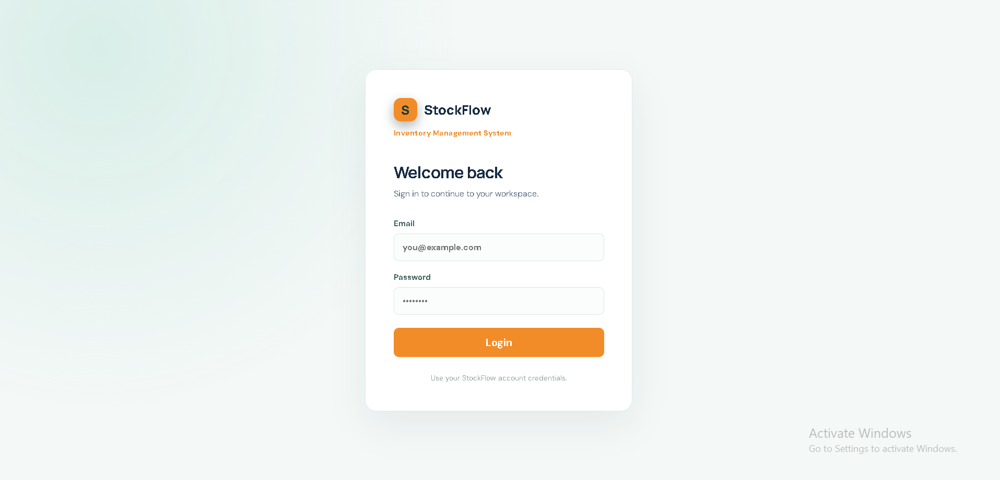
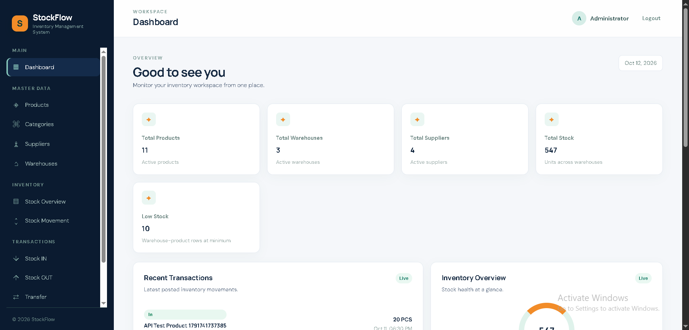
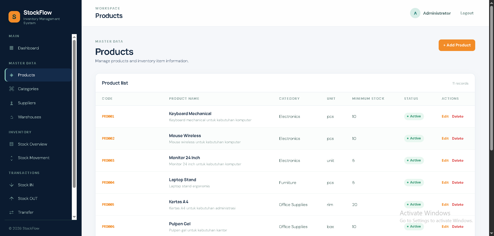
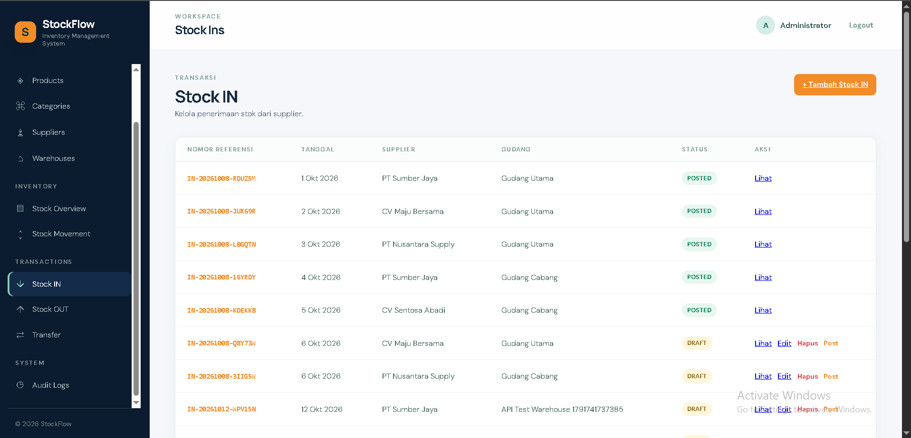
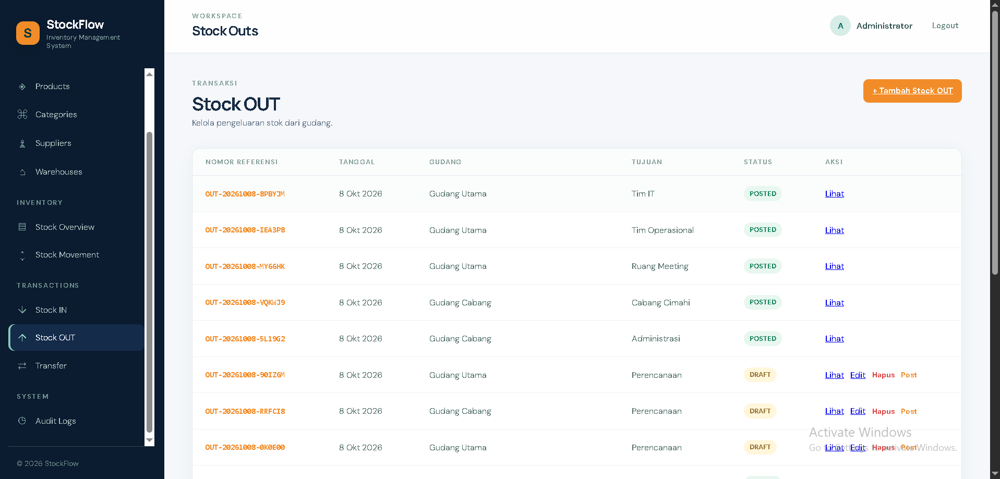

# StockFlow — Inventory & Warehouse Management System

StockFlow is a web-based inventory and warehouse management system designed to help manage products, stock movements, and warehouse operations in one application.

The system provides a centralized interface for monitoring inventory, recording incoming and outgoing stock, managing warehouse transfers, and tracking operational activities.

## Features

- **Dashboard** — View inventory summaries and key information.
- **Authentication** — Log in to access protected application features.
- **Product Management** — Manage product records.
- **Category Management** — Organize products by category.
- **Warehouse Management** — Manage warehouse information and monitor stock by warehouse.
- **Supplier Management** — Manage supplier records.
- **Stock In** — Record and manage incoming stock transactions.
- **Stock Out** — Record and manage outgoing stock transactions.
- **Warehouse Transfers** — Manage stock transfers between warehouses.
- **Stock Movements** — Review inventory movement history.
- **Audit Logs** — Review recorded application activities.

## Screenshots

### Login



### Dashboard



### Products



### Stock In



### Stock Out



## Tech Stack

**Backend**
- Go
- Goravel

**Frontend**
- React 18
- React Router
- Vite 6
- JavaScript
- CSS

**Database**
- MySQL

## Project Structure

```text
stockflow/
├── backend/
│   ├── app/
│   ├── bootstrap/
│   ├── config/
│   ├── database/
│   ├── resources/
│   ├── routes/
│   ├── tests/
│   ├── go.mod
│   └── main.go
├── frontend/
│   ├── public/
│   ├── src/
│   │   ├── components/
│   │   ├── pages/
│   │   ├── services/
│   │   ├── App.jsx
│   │   └── styles.css
│   ├── package.json
│   └── vite.config.js
├── screenshots/
├── .env.example
└── README.md
```

## Requirements

Before running StockFlow, make sure the following tools are installed:

- Go
- Node.js and npm
- MySQL
- Git

## Installation and Setup

### 1. Clone the repository

```bash
git clone https://github.com/amrullah-dev/stockflow.git
cd stockflow
```

### 2. Configure the backend

```bash
cd backend
```

Copy `.env.example` to `.env`, then configure the required application and MySQL database settings.

```bash
go mod download
```

Run the database migrations using the project's configured Goravel Artisan commands, after checking the required database configuration.

### 3. Start the backend

From the `backend` directory, start the application using the development command configured for this project.

For projects configured to use the Goravel Artisan server command:

```bash
go run . artisan serve
```

### 4. Configure the frontend

Open another terminal in the project root, then run:

```bash
cd frontend
npm install
```

Copy `.env.example` to `.env` if required, and configure the frontend API URL to point to the running backend.

### 5. Start the frontend

```bash
npm run dev
```

Open the local URL displayed by Vite in your terminal.

> **Note:** Make sure the backend API, MySQL connection, and frontend API URL are configured correctly before using the application.

## Development

Build the frontend for production:

```bash
cd frontend
npm run build
```

Preview the production frontend build:

```bash
npm run preview
```

## Purpose

StockFlow is a project focused on inventory and warehouse management, with an emphasis on organizing stock records, transaction workflows, and inventory visibility across warehouses.

## Developer

**Muhammad Amrullah**

GitHub: [@amrullah-dev](https://github.com/amrullah-dev)
